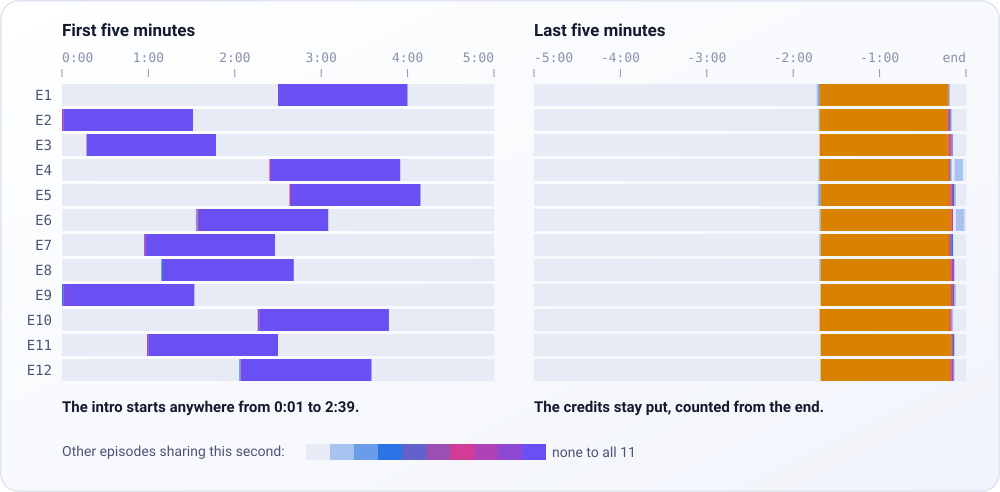
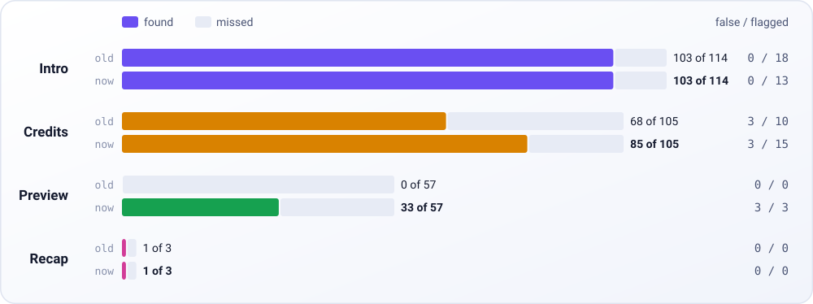

<picture>
  <source media="(prefers-color-scheme: dark)" srcset="assets/hero-dark.svg">
  
</picture>

IntroKiller Engine finds the intros, credits and next-episode previews in a season of a show, and writes down when each one starts and ends.

Despite the name, the engine never cuts a video. It only writes out times, and your player decides what to do with them. When the engine is not sure, it reports nothing. A missed intro costs you a minute, and a wrong skip can cost you part of the plot.

## Try it

You need Python 3.10 or later and [FFmpeg](https://ffmpeg.org/download.html) 5.1 or later.

```sh
git clone https://github.com/tikkamasalla/introkiller-engine
cd introkiller-engine
python -m venv .venv
source .venv/bin/activate    # Windows: .venv\Scripts\activate
pip install .
introkiller scan "path/to/Show/Season 1"
```

To try it on a real series, download [Pioneer One](https://en.wikipedia.org/wiki/Pioneer_One), a Creative Commons series, with `python tools/fetch_demo.py pioneer`. The engine prints this:

```text
Pioneer One E01  (31:36.4)
  nothing certain enough to report
Pioneer One E02  (38:42.0)
  nothing certain enough to report
Pioneer One E03  (31:14.7)
  intro      4:30.0 -   4:59.2
Pioneer One E04  (33:46.7)
  intro      4:40.4 -   5:00.0
Pioneer One E05  (37:44.0)
  intro      3:07.6 -   3:40.9
Pioneer One E06  (44:00.3)
  intro      3:53.0 -   4:26.6
```

The times are also saved as JSON in a `skip-times` folder. Add `--format edl,mpv,chapters` for files that mpv or Kodi can read, `--ocr` to read on-screen credits (after `pip install ".[ocr]"`), and `--recap` to look for recaps.

## How it works

The engine compares the audio of the episodes in a season and looks for the part they all share. You do not tell it where the intro is.

<picture>
  <source media="(prefers-color-scheme: dark)" srcset="assets/heat-dark.svg">
  
</picture>

Each row is an episode of *Legend of the Galactic Heroes: Die Neue These*, and a bright band marks audio shared with the other episodes. A cold open (a scene before the title sequence) moves the intro from episode to episode, so a fixed rule such as "skip 0:00 to 1:30" would fail here. The engine finds the intro wherever it sits.

The engine then checks the picture too, so a song that plays over a new scene does not count. The exact rules are in [docs/METHOD.md](docs/METHOD.md).

## How well it works

<picture>
  <source media="(prefers-color-scheme: dark)" srcset="assets/scoreboard-dark.svg">
  
</picture>

We tested the engine on 123 episodes chosen because they are hard. It found 103 of 114 intros, 85 of 105 credits (99 with `--ocr`), 33 of 57 previews and 1 of 3 recaps. Recaps are the weakest result. A partial segment counts as found.

Of the results, 31 were off by more than a second. We checked each against the video, and none cut into the story. Most were reference times (the correct times we score against) that were slightly off themselves.

We tuned the engine on these same episodes, so expect lower scores on shows it has not seen. Across the 117 episodes with published times, it gives back 5.4 of 51 hours.

## Comparison with other tools

We ran two similar tools on our episodes with the same scoring. Both tests favour us, because we tuned on these episodes and the other tools had never seen them.

skipmark, tested on 123 episodes, found 112 of 114 intros to our 103, and 105 of 105 credits to our 85 (99 with `--ocr`). Its results were off by more than a second 115 times, against our 31, because it often overshoots. It is built for audio series and heard only the first and last few minutes of each file.

Media Preview Generator, tested on 31 episodes, found 20 of 27 intros to our 27, and 18 of 26 credits to our 16 (25 with `--ocr`). Its results were off by more than a second 24 times, against our 10. It ran without the chapters and online sources it normally uses.

We also tested ScenePass v0.9.5, a closed-source tool, on the same 31 episodes as Media Preview Generator. By default it holds every result for your review and applies none. Counting held results, it found 25 of 27 intros to our 27, with 1 wrong skip to our 0. It won on recaps, 3 of 3 to our 1 of 3, though only 3 recaps were tested and it also produced 5 false recaps to our 0. We tuned on these episodes and ScenePass did not, so the test favours us.

If you use Plex, Emby or Jellyfin, start with the tools built for them. Plex and Emby include this feature, and [Intro Skipper](https://github.com/intro-skipper/intro-skipper) and [Media Preview Generator](https://github.com/stevezau/media_preview_generator) add a skip button to your server. This engine does not. Use it when you want the times themselves, for mpv, Kodi, your own player or a database. The [Stremio patches](https://github.com/tikkamasalla/stremio-morphe-patches) already use them.

## Mistakes we found and fixed

- Seven series ids in our first results were wrong. *Planetes* pointed at *Movies for Guys Who Like Movies*. The engine now checks every id.
- Every black frame looks like every other black frame, so fades kept matching. Black no longer counts as evidence.
- A second recap method found all three recaps, then cut a second of story from one. We dropped it.

## Limits

The engine needs at least two episodes of a season, and three is better. Without `--ocr`, it misses credits with different music in every episode. It cuts short intros that cross the 5-minute mark, and it mostly fails on films. We have not tested the EDL files in Kodi itself, or run the engine on macOS.

[docs/DETAILS.md](docs/DETAILS.md) has the full scoreboard, the Pioneer One test, the other tools we looked at and more mistakes.

## Licence

GPL-3.0. The two Pioneer One frames in `assets/` stay under the licence stated in the episodes, CC BY-NC-SA, and belong to creators Josh Bernhard and Bracey Smith.
