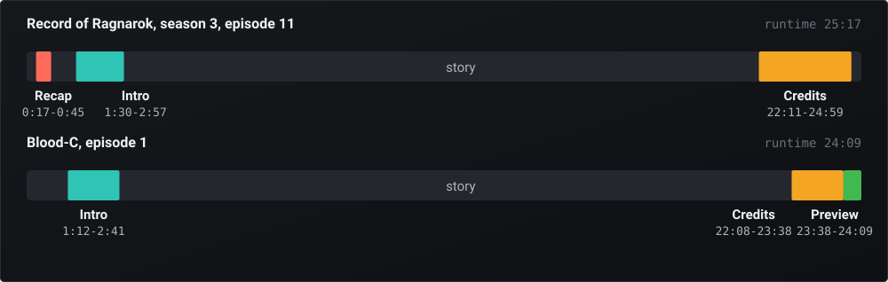
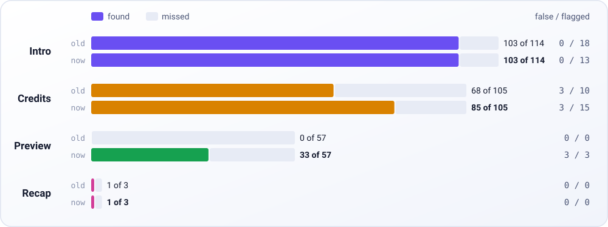
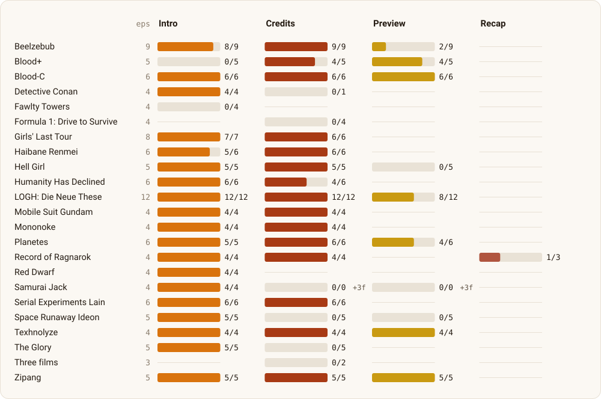
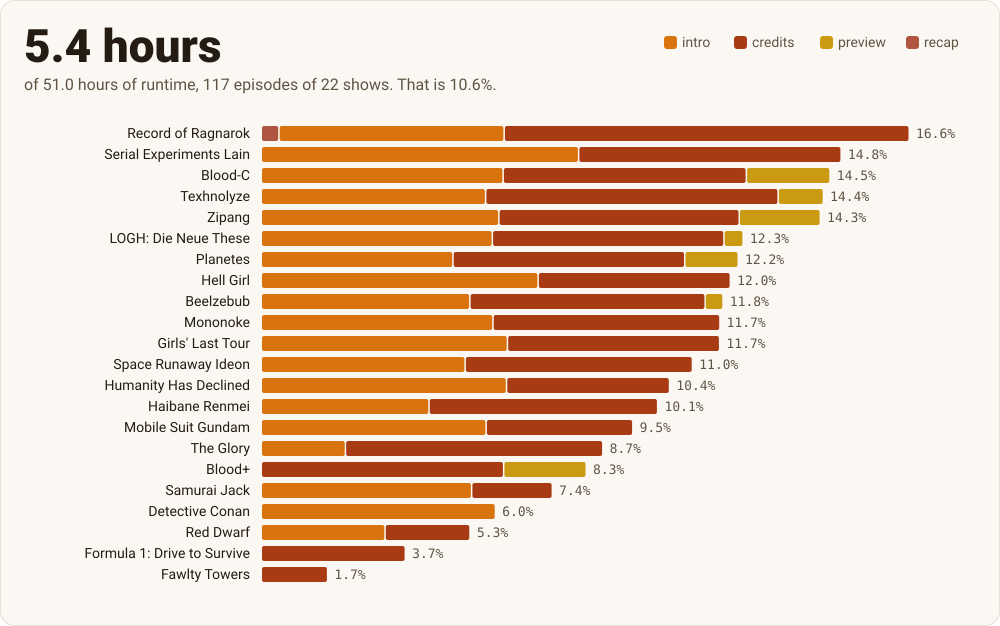
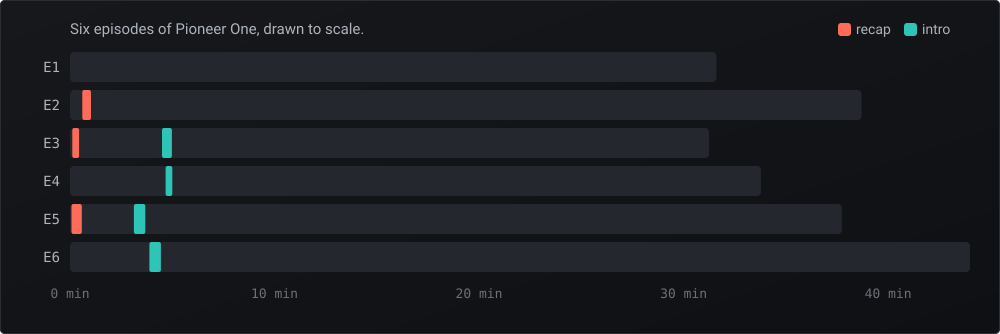
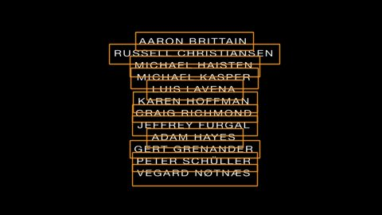

# Details

The long version of the [README](../README.md): every score, the Pioneer One test, every rival we compared and how people can use the results.

## Anatomy of an episode

<picture>
  <source media="(prefers-color-scheme: dark)" srcset="../assets/anatomy-dark.svg">
  
</picture>

Both are real rows from the published results. The story does not always come first, the intro is rarely at zero, and a preview can start on the very next frame after the credits. We found no single episode with all four parts in our results, so here are two.

## The scoreboard

<picture>
  <source media="(prefers-color-scheme: dark)" srcset="../assets/scoreboard-dark.svg">
  
</picture>

| On 123 episodes | Found | Missed | False | Flagged | Ate story, after checking frames |
|---|---:|---:|---:|---:|---:|
| Intro | 103 | 11 | 0 | 13 | 0 |
| Credits | 85 | 20 | 3 | 15 | 0 |
| Preview | 33 | 24 | 3 | 3 | 0 |
| Recap | 1 | 2 | 0 | 0 | 0 |

"Old" is the previous version of this engine, on the same episodes. Its preview column is zero because it had no preview stage.

The 123 episodes come in 23 sets, chosen to be awkward: cold opens, mid-episode intros, changing theme songs, previews, three films. For 86 episodes the reference is the named chapter marks in the file itself, which the engine never reads. For 9 it is unnamed chapters whose meaning we checked on frames, and for 28 it was written from the frames.

Found means a segment of the right type came back when the reference has one. False means one came back when it has none. Flagged means more than 1.0 s of a returned segment lies outside the reference, which is the strict test for a wrong skip.

All 31 flagged segments were then judged on frames, and none eats story or preview. Most are chapter marks that sit a second or so off the real boundary: on Blood-C, the chapter ends 1.4 s before the credits' last card leaves the screen. The 3 false credits are real credit rolls on Samurai Jack, where the frame-written reference lists only the intro. The 3 false previews are not previews at all, just 10.5 s of studio logos. They eat nothing, and they stay wrong.

Now, what this does not prove. We tuned the engine on these same episodes, so treat this as a development score, not a blind test. "Found" is also generous, since a partial segment counts, so here is how close the found ones actually came. Hits were accepted against the reference and not all re-opened on frames, and some flagged verdicts lean on an earlier frame check of the same segment.

| Found segments | Median start error | Median end error | Median share of the reference covered | Covered less than 90% |
|---|---:|---:|---:|---:|
| Intro | 0.79 s | 0.09 s | 98.5% | 9 of 103 |
| Credits | 0.17 s | 0.96 s | 98.9% | 7 of 85 |
| Preview | 0.29 s | 0.00 s | 99.1% | 0 of 33 |
| Recap | 12.05 s | 33.44 s | 37.6% | 1 of 1 |

With `--ocr`, credits rise from 85 to 99 of 105. It also adds 7 credit rolls on episodes whose reference lists no credits, which we opened on frames and which are real, though the rules score them as false. Text starts run late, up to about two minutes on *The Glory*, which is the safe direction.

<details>
<summary>Every set, including the zeros</summary>
<picture>
  <source media="(prefers-color-scheme: dark)" srcset="../assets/shows-dark.svg">
  
</picture>
A dash means the reference has none of that type, and +3f means three false results. The numbers are in <a href="../data/scoreboard.json">data/scoreboard.json</a>.
</details>

## Time given back

<picture>
  <source media="(prefers-color-scheme: dark)" srcset="../assets/hours-dark.svg">
  
</picture>

Across the 245 published segments, one watch-through of these episodes contains 5.4 hours you have already seen or will not miss: 2.71 hours of credits, 2.46 of intros, 0.22 of previews, and one lonely 27-second recap. The median intro runs 88 s and the median credits 89 s. A low share on this chart can mean a show has less to skip or that the engine missed it: Fawlty Towers has a title sequence, and our score for it is 0 of 4.

## Hall of shame

The mistakes taught us more than the hits did. Each of these happened, and each left a rule behind.

| What went wrong | The rule it left |
|---|---|
| While checking our times against hand-entered online credit windows, some of 277 to 326 s turned out to include real mid-credits scenes. Windows that survived ran about 100 s, and our own 108 credits have a median of 89 s and a 90th percentile of 104 s. These windows came from careful volunteers, and long credits are hard to mark. | The player using our times shows a button, never an auto-skip, for any online credits window over 180 s. |
| An earlier version found a 19 s scrap of Blood+'s 94 s opening, and the scorer happily counted 5 hits. | Short pieces need verified edges now. The score went from 108 to 103 on purpose, and we show the median cover above so hits cannot flatter us. |
| The on-screen text stage called 51 s in the middle of a Detective Conan episode "credits", and got 4 of 26 wrong overall in its first measurement. | Text results count only if they run to the end of the file, and only where matching found nothing. |
| A streamed decode silently lost its first 5.12 s on one episode, which shifted every time in that window. | A decode that comes back short is refused unless the audio truly ends there. |
| A black frame hashes to all zeros, so black always "matched" black. Fades looked like shared picture. | Black counts toward the share, but it is never evidence of where a segment starts or ends. |
| Seven series ids in our first draft of the results were wrong. *Planetes* pointed at *Movies for Guys Who Like Movies*, and *Mobile Suit Gundam* at *Billy*. | Every id is now checked by name and by whether the episode exists. |
| Recaps: 1 of 3, and that one covers 38% of the real recap. A second method found all three, then ate about 1 s of story on one of them. | We dropped it. One second of story outranks every recap we will ever miss. |

## The demo: Pioneer One

Our scored episodes cannot ship with this repo, so here is a test anyone can repeat. [Pioneer One](https://en.wikipedia.org/wiki/Pioneer_One) is a six-episode series created by Josh Bernhard and Bracey Smith. A card in the episodes states a Creative Commons Attribution-NonCommercial-ShareAlike licence, and the [copies on archive.org](https://archive.org/details/pioneer-one-ep.-1-earthfall-pilot) list CC BY-SA 4.0. We go by the card.

```sh
python tools/fetch_demo.py pioneer        # 3.39 GB over HTTPS, with a hard stop at 5 GB
introkiller scan pioneer --recap --ocr
```

<picture>
  <source media="(prefers-color-scheme: dark)" srcset="../assets/demo-dark.svg">
  
</picture>

We then opened the frames around every result and compared it with what is on screen.

| Episode | Recap found | Intro found | Title sequence by eye | How it did |
|---|---|---|---|---|
| 1 | | | none separate, titles run over the story | correct silence |
| 2 | 0:36 to 1:01 | | ends about 6:45 | intro missed, picture share 0.56 against the 0.60 gate |
| 3 | 0:07 to 0:26 | 4:30.0 to 4:59.2 | about 4:27 to 5:04 | 3 s late, 5 s short |
| 4 | | 4:40.4 to 5:00.0 | about 4:38 to 5:15 | 2 s late, 15 s short, stopped at the 5-minute window; recap missed |
| 5 | 0:04 to 0:35 | 3:07.6 to 3:40.9 | about 3:05 to 3:41 | 3 s late, end on the mark |
| 6 | | 3:53.0 to 4:26.6 | about 3:50 to 4:27 | 3 s late, end on the mark; recap missed |

So it found 4 of 5 title sequences and 3 of 5 "previously on" recaps, and nothing ate story. Credits came to 0 of 6, and that one is instructive. Matching refused them, because the name cards differ per episode and the picture share stayed between 0.00 and 0.45. The text stage then found a text run in the credits of all six episodes and refused all six too, because each run stops before the file does, and only runs that reach the end are kept. That rule protects other shows from a false skip, and here it costs every credits result. They are all listed under `rejected` in `details/`.

<p align="center">
  
  
  <br><sub>Left: inside the found intro, episode 5. Right: what the text stage sees in episode 3's credits, with its 12 boxes drawn on. From Pioneer One, CC BY-NC-SA.</sub>
</p>

## Against the field

The method here is not unique, and it would be silly to claim it. Matching theme audio across a season is what Plex, Emby and others do too, and [Media Preview Generator](https://github.com/stevezau/media_preview_generator) is our closest relative. What we did not find, among the 26 detection projects and 4 community databases we compared, is a published per-show score on real episodes that covers next-episode previews, with misses and false results in view. The nearest is the [thesis](https://github.com/nielstenboom/masterthesis/raw/master/main.pdf) behind recurring-content-detector, which charts previews and other classes on 80 files, but not per show. That is a statement about what has been measured and published, not about who had the idea first.

| Project | Needs a server | Intro | Credits | Next-episode preview | Recap | Uses the picture | Reads on-screen text | Score on real episodes |
|---|---|---|---|---|---|---|---|---|
| **IntroKiller Engine** | no | yes | yes | yes, 33 of 57 | weak, 1 of 3 | yes | optional | yes, per show |
| Plex ([intros](https://support.plex.tv/articles/skip-content/), [credits](https://support.plex.tv/articles/credits-detection/)) | yes, plus Plex Pass | yes | yes | not listed | not listed | yes, [for credits](https://www.mactrast.com/2023/02/plex-now-allows-viewers-to-skip-the-credits-at-the-end-of-shows-and-movies-with-a-click-of-the-remote/) | yes, for credits | credits around 93% per [staff](https://forums.plex.tv/t/credit-detection-making-mistakes/831210), test set not described |
| [Emby](https://emby.media/support/articles/Intro-Skip.html) | yes, plus Premiere | yes | [plugins only](https://emby.media/community/topic/145091-plugin-embycredits-detect-end-credits-and-add-auto-skip/) | not listed | not listed | not published | not listed | not published |
| [Jellyfin Intro Skipper](https://github.com/intro-skipper/intro-skipper) | yes | yes | yes | partial: [chapters, opt-in subtitles or credits end](https://github.com/intro-skipper/intro-skipper/blob/12.0/docs/analysis.md) | yes | yes | partial | not published |
| [Media Preview Generator](https://github.com/stevezau/media_preview_generator) | yes, Docker feeding servers | yes | yes | from chapters or online databases | same | partial | yes | yes, totals; ours below |
| [skipmark](https://github.com/Rakshit-gen/skipmark) | no | yes | yes | yes | yes | no, audio series | no | its own [synthetic shows](https://github.com/Rakshit-gen/skipmark#limits); ours below |
| [SkipForge](https://github.com/jamieelliston/skipforge) | Docker web app | partial: start to a marker image | yes, marker image | no | no | yes | no | not published |
| [recurring-content-detector](https://github.com/nielstenboom/recurring-content-detector) | no, Python or Docker | yes | yes | yes | yes | yes, picture only | no | yes, totals on 80 files |
| Hand marking, the streaming-service way | no | yes | yes | yes | yes | a person | a person | not published |
| Community databases: [AniSkip](https://github.com/lexesjan/typescript-aniskip-extension), [TheIntroDB](https://theintrodb.org/), [IntroDB.app](https://introdb.app/), [SkipDB](https://skipdb.tv/docs) | no, online lookup | yes | yes | some sites | some sites | people submit | people submit | not published |

Here is where others beat us, plainly. Plex and Emby are built in: press a button in the app, with little or no setup, and a person who wants that should stop reading here. Intro Skipper lives inside Jellyfin, is far more widely used, has a real recap stage, and we have nothing that puts a button on your TV. Media Preview Generator writes markers into Plex, Emby and Jellyfin at once, reads on-screen credits on single files and movies, merges online sources, and runs on arrival from Sonarr or Radarr. skipmark finds ads as well as recaps, and anyone can rerun its benchmark from the repo, which we cannot offer because our test episodes cannot ship. SkipForge gives you a review queue and writes server markers. recurring-content-detector goes after recaps and previews from pictures alone, and [ScenePass](https://github.com/lynxstrike/ScenePass.repo) goes after recaps with speech recognition and subtitles, right where we are weakest. Community databases work on one episode, instantly, with no compute at all, whenever somebody has already done the work.

This project exists because of the gaps people keep describing. One Plex user found that [the skip button goes missing](https://forums.plex.tv/t/intro-credit-skip-problems-and-a-feature-request/835342) when a preview follows the credits. [Another reported](https://forums.plex.tv/t/credit-detection-making-mistakes/831210) that on animated shows the credit markers were wrong in "easily more than half the episodes", in the same thread where Plex staff put credits at around 93% on their own test set. Both can be true, and neither is a measurement of Plex on our episodes, which we do not have.

### Two rivals, on our episodes

We ran two of these on our test episodes, with our scorer unchanged and online sources off. Both tests favour us, because we tuned on these episodes and the others never saw them. Read the margins as an upper limit, not a blind result. The numbers are in [data/head_to_head.json](../data/head_to_head.json).

**skipmark, all 123 episodes, default settings.** It is built for audio series, and here it heard only the first and last 5 minutes or so of each file, padded with silence to full length.

| | skipmark | IntroKiller Engine |
|---|---:|---:|
| Intros: returned, of 114 | 112 | 103 |
| Intros: covering at least half the reference | 105 | 103 |
| Intros: covering at least half, with no wrong skip | 74 | 90 |
| Credits: returned, of 105 | 105 | 85, or 99 with `--ocr` |
| Credits: covering at least half the reference | 77 | 82 |
| Credits: covering at least half, with no wrong skip | 40 | 70 |
| Previews, of 57 | 3 | 33 |
| Recaps, of 3 | 0, plus 9 false | 1 |
| Segments more than 1.0 s outside the reference | 115 | 31 |
| Seconds landing outside every reference segment | 1236 | 156 |
| Median and 90th percentile edge error | 1.07 s, 62.07 s | 0.34 s, 2.32 s |

The 156 s is the raw figure, before the frame checks described in the scoreboard, and skipmark's results did not get those checks. It also returned 69 "ads", which added 700 s outside the reference, and 26 of them were really intros, credits or previews under the wrong name. Where it beat us: Fawlty Towers intros, 3 of 4 against our 0, and Blood+ intros, 5 of 5 against our 0, though most of those run past the real edges. It also returns something for credits on sets where we return nothing.

**Media Preview Generator, 31 episodes, using its own test harness.** Chapters were stripped and online sources were off, so this tests its detectors, not the whole product, which normally has those sources to lean on. Without a second source its High tier publishes nothing, so the row below is its Medium tier. It saw 3 or 4 episodes per show, while some of our results come from runs with more episodes of the same show.

| | Media Preview Generator | IntroKiller Engine |
|---|---:|---:|
| Intros found, of 27 | 20 | 27 |
| Intros wrong by more than 1.0 s, after known reference errors | 7 | 0 |
| Intro median start error | 1.01 s | 0.79 s |
| Credits found, of 26 | 18 | 16, or 25 with `--ocr` |
| Credits wrong by more than 1.0 s, after known reference errors | 5 | 0 |
| Credits median start error | 19.0 s | 0.13 s |
| Previews and recaps | not a feature | 5 of 9, 1 of 3 |

On our default run it won credits coverage, including all 3 episodes each of *The Glory*, *Drive to Survive* and *Ideon*, where matching found nothing. Our optional `--ocr` stage closes that gap: the same 9 episodes are found, for 25 of 26 against its 18. Those 9 start up to 124 s late, which leaves some credits on screen and is the safe direction, and the text rules were tuned on these episodes too. The error rows above are for the default run only. It also found 5 real credit rolls that our reference leaves out, on *Red Dwarf* and *Detective Conan*. We counted those for it rather than as false results. `--ocr` finds 2 of them, and our default run finds none. Its own [evaluation notes](https://github.com/stevezau/media_preview_generator/blob/dev/tools/markers_eval/README.md) report 91 useful, 12 wrong and 15 missed intros on 118 episodes, and 59 of 80 credits within 10 s, on its own files and looser rules.

The rest of what we compared: [needle](https://github.com/aksiksi/needle), [Skiptro](https://github.com/MikeSiLVO/skiptro-releases), [AniChapters](https://github.com/56cla/AniChapters), [iina-skip-intro](https://github.com/pparanoiidd/iina-skip-intro), [ScenePass](https://github.com/lynxstrike/ScenePass.repo), [EmbyCredits](https://github.com/yocksers/EmbyCredits), [Kodi Intro Skipper](https://github.com/CvH/kodi-intro-skipper), [Skip-emby](https://github.com/dandan658/Skip-emby), [intro-skipper-node](https://github.com/GOvEy1nw/intro-skipper-node), [Mydia](https://github.com/getmydia/mydia), [analyzer](https://github.com/zaentrum/analyzer), [contentDetectron](https://github.com/fertlopus/contentDetectron), [end-credits-detection](https://github.com/thiago-franco/end-credits-detection), [Credit Scout](https://github.com/PatrickKalkman/credit-scout), [credroll](https://github.com/debrup416/credroll), [Content-Seperator](https://github.com/dhruv7539/Content-Seperator), [series-player](https://github.com/althropic/series-player), [plex-credits-detect](https://github.com/cjmanca/plex-credits-detect) (retired) and [Jellyfin Media Analyzer](https://github.com/endrl/jellyfin-plugin-media-analyzer) (archived).

## What people can do with it

### Fill the gaps in a media server

Your server missed a season, or you do not pay for the tier that detects it. Run `introkiller scan Season1 --format chapters`, then `ffmpeg -i ep.mkv -i ep.ffmeta -map_metadata 1 -map_chapters 1 -map 0 -c copy ep-chapters.mkv` to make a copy with named chapters. Tools that read chapter names, such as Intro Skipper, can use those.

### Skip in Kodi or mpv with no plugin

`--format edl,mpv` writes both. Put `ep.edl` next to `ep.mkv` and [Kodi](https://kodi.wiki/view/Edit_decision_list) skips each marked part once. For mpv, open `ep.mpv.edl` and the marked parts are simply absent: on one Pioneer One episode, a 37:44 file plays as 37:10. Prefer chapters? `mpv --chapters-file=ep.ffmeta ep.mkv` works too. Previews are left out of both skip lists on purpose.

### Build it into a player or addon

Read `times.json` and seek. These same results already power the "own times" source in [stremio-morphe-patches](https://github.com/tikkamasalla/stremio-morphe-patches), and [the published files](https://github.com/tikkamasalla/stremio-morphe-patches/tree/skip-data/times) show the format at scale.

### Contribute to a community database

Scan a season nobody has covered, open the edges yourself, and submit what holds up. The `d` field lets a database match your times to the right cut.

### Catalogue a collection

`details/<episode>.json` records every segment with the evidence behind it, and every candidate it refused with the reason. It runs offline, reads only, and never asks the internet about your files.

## Credits

GPL-3.0, see [LICENSE](../LICENSE). Built on [FFmpeg](https://ffmpeg.org), [NumPy](https://numpy.org), [OpenCV](https://opencv.org), and for `--ocr`, [RapidOCR](https://github.com/RapidAI/RapidOCR). Charts rebuild from `data/` with `python tools/build_charts.py`.

The two Pioneer One frames in `assets/` come from *Pioneer One*, created by Josh Bernhard and Bracey Smith, and stay under the licence its makers state in the episodes: Creative Commons Attribution-NonCommercial-ShareAlike. Show names in the charts identify what was measured, and no frames from those shows are included.
